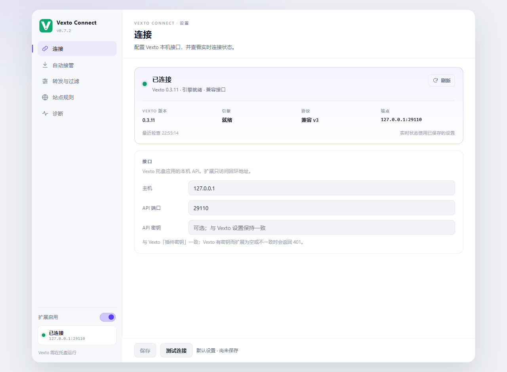

# Vexto Connect

把浏览器下载交给本机 Vexto 的浏览器扩展。

在网页里点击下载、或在链接上右键选择「用 Vexto 下载」，任务会直接进入本机 Vexto 的下载队列，不再经过浏览器的下载管理。Vexto 未运行、拒绝接收或响应超时时，扩展会自动回落到浏览器原生下载，并说明原因，不丢任务。



Manifest V3 · Edge / Chrome 109+ · Firefox 115+ · GPL-3.0

---

## 功能

- **自动接管**（默认开启）：浏览器创建下载后立即暂停，交给 Vexto；成功后取消浏览器下载，失败则恢复浏览器下载。
- **右键交接**：在链接上右键选择「用 Vexto 下载」，直接把链接交给 Vexto。
- **失败回落**：Vexto 未运行、密钥不一致（401）、超时或被拒绝时，自动恢复浏览器下载，并弹出通知说明原因。
- **转发请求头**：默认转发 Referer 与 User-Agent，便于需要防盗链或 UA 校验的站点。
- **可选 Cookie 转发**：默认关闭；开启后把当前站点的 Cookie 交给本机 Vexto，用于需要登录态的下载。
- **过滤规则**（仅自动接管）：站点允许 / 排除列表、最小文件大小、大小未知时的策略、重复下载保护窗口。
- **隐藏下载列表**（默认开启，仅 Chrome / Edge）：接管尝试期间临时隐藏下载列表与气泡，回落到浏览器下载时恢复显示。
- **实时状态面板**：选项页显示 Vexto 连接状态、版本、引擎、协议与最近检查时间。
- **诊断记录**：保留最近 50 条交接结果，只记录主机与原因码，不记录 URL 查询串、Cookie、密钥或文件名。

## 工作原理

```text
网页下载 / 右键链接
        │
        ▼
Vexto Connect（浏览器扩展）
        │  HTTP 127.0.0.1:29110
        ▼
Vexto 桌面端（托盘运行）
```

扩展只访问本机回环地址，不访问公网，也不会上传任何数据。

## 兼容性

| 浏览器 | 支持情况 |
|---|---|
| Microsoft Edge 109+ | 支持，已在 Edge 158 完整实测 |
| Google Chrome 109+ | 支持，已在 Chrome 158 完整实测 |
| Mozilla Firefox 115+ | 支持，已在 Firefox 160 实测（自动接管、回落、诊断） |
| Brave / Opera / Vivaldi 等 Chromium 浏览器 | 理论可用，未逐一实测 |
| Safari | 不支持（扩展模型与下载 API 不同） |
| 移动端浏览器 | 不支持（移动版 Chrome / Edge 不支持扩展） |

界面与文档目前仅提供中文。

Vexto 侧需要开启插件接管。当前扩展使用 Vexto 的兼容接口；Vexto 提供 `/v1` 接口后会自动切换。

## 安装

扩展尚未上架浏览器商店，目前通过加载解压缩目录安装。

### 前置条件

1. Vexto 已安装并在托盘运行。
2. 在 Vexto 设置中开启「插件接管」，确认端口（默认 `29110`）。
3. 如果 Vexto 设置了「插件密钥」，稍后在扩展选项页填写相同密钥。

### 加载扩展

1. 下载或克隆本仓库。
2. 打开扩展管理页：
   - Edge：`edge://extensions`
   - Chrome：`chrome://extensions`
3. 打开「开发者模式」。
4. 点击「加载已解压的扩展程序」，选择本仓库根目录。
5. 打开 Vexto Connect 的选项页，确认主机 `127.0.0.1`、端口 `29110`，按需填写密钥，点击「测试连接」。
6. 确认「自动接管浏览器下载」已开启（默认开启），按需调整其他设置并保存。

### 加载扩展（Firefox）

Firefox 的清单与 Chromium 不同，需要先构建 Firefox 包：

```powershell
powershell -ExecutionPolicy Bypass -File scripts/package-firefox.ps1
```

解压 `dist/vexto-connect-firefox-<版本号>.zip`，然后：

1. 打开 `about:debugging#/runtime/this-firefox`；
2. 点击「临时载入附加组件」；
3. 选择解压目录中的 `manifest.json`；
4. 打开扩展选项页，确认端口与密钥，点击「测试连接」。

临时载入的扩展在 Firefox 重启后失效；长期使用需要发布到 AMO（addons.mozilla.org）获取签名，或使用未列出（unlisted）签名包。

### 打包

```powershell
powershell -ExecutionPolicy Bypass -File scripts/package.ps1
```

生成 `dist/vexto-connect-<版本号>.zip`（Chrome / Edge）。

```powershell
powershell -ExecutionPolicy Bypass -File scripts/package-firefox.ps1
```

生成 `dist/vexto-connect-firefox-<版本号>.zip`（Firefox）。两个包都包含 manifest、脚本、选项页、图标、README 与 LICENSE，不包含文档、`.git` 或测试文件。

## 使用

### 自动接管

在选项页「自动接管」中开启并保存。之后浏览器开始下载时：

- 下载会先被暂停，扩展在 1 秒内请求 Vexto；
- Vexto 接收：取消并清除浏览器下载，任务出现在 Vexto 中；
- Vexto 拒绝、未运行、密钥不一致或超时：恢复浏览器下载，并通知具体原因。

### 右键下载

在链接上右键选择「用 Vexto 下载」。这是显式操作，不受站点规则、大小或重复保护限制。

### 过滤

- **站点规则**：每行一个域名，按域名后缀匹配（`example.com` 同时匹配 `sub.example.com`）；允许列表非空时只接管命中的站点。
- **最小文件大小**：小于该值的下载不接管；大小未知时按「仍然接管」开关决定。
- **重复保护**：同一 URL 与文件名在窗口时间内只交给 Vexto 一次。

### 隐藏下载列表

开启后需要授权可选的「下载 UI」权限。隐藏只在接管尝试期间生效：接管成功不会留下浏览器下载项，回落到浏览器下载时列表会恢复显示。

## 权限说明

| 权限 | 类型 | 用途 |
|---|---|---|
| `storage` | 必需 | 保存设置与诊断记录 |
| `contextMenus` | 必需 | 注册「用 Vexto 下载」右键菜单 |
| `downloads` | 必需 | 暂停、取消、恢复浏览器下载 |
| `notifications` | 必需 | 回落时提示失败原因 |
| `cookies` | 必需 | 可选的 Cookie 转发（默认关闭，开启后才读取） |
| `downloads.ui` | 可选（仅 Chrome / Edge） | 隐藏浏览器下载列表；Firefox 不支持该 API |
| `http://127.0.0.1/*`、`http://localhost/*` | 必需 | 访问本机 Vexto API |
| `*://*/*` | 可选 | 仅在开启 Cookie 转发时申请，用于读取站点 Cookie |

扩展只申请完成上述功能所需的最小权限；可选权限只在用户主动开启对应功能时申请。

## 隐私与安全

- **只访问本机**：所有网络请求都发往 `http://127.0.0.1` 或 `http://localhost`，不访问公网。
- **不收集数据**：没有统计、遥测、账号体系或远程上报。
- **Cookie 默认不转发**：只有用户主动开启后，才会读取当前站点 Cookie 并发送给本机 Vexto；Cookie 与密钥不写入日志。
- **密钥只存本地**：保存在 `chrome.storage.local`，不使用同步存储。
- **诊断已脱敏**：只记录主机与原因码，不记录 URL 查询串、Cookie、密钥或文件名；浏览器会话结束即清空。
- **无远程代码**：不加载远程脚本，不使用 `eval` / `new Function`，CSP 使用 Manifest V3 默认值。
- **可审计**：全部代码为纯静态 HTML / CSS / JS，无构建产物。

## 已知限制

- 隐藏下载列表是浏览器的全局 UI 开关。`onCreated` 在浏览器创建下载项之后才派发，下载栏可能短暂闪现；要完全避免只能常驻隐藏，但那样回落的下载也会不可见。
- Firefox 的 `downloads.pause()` 会让下载变成 `USER_CANCELED` 且无法恢复，因此 Firefox 版不暂停下载，而是直接交接；接管成功的下载可能在取消前写入少量数据，随后由扩展删除。
- Firefox 不支持 `downloads.ui`，选项页会自动隐藏「隐藏浏览器下载列表」。
- 小文件可能在暂停生效前就下载完成。接管成功时会删除浏览器副本，回落到浏览器时保留文件。
- 扩展不能启动 Vexto，Vexto 必须保持托盘运行（可开启开机自启）。
- 与 Rayburst Connect 同时开启自动接管会重复拦截，请只启用其中一个。
- 项目处于 0.x 早期阶段，设置项与行为可能随版本调整。

## 故障排查

| 现象 | 可能原因与处理 |
|---|---|
| 测试连接提示「无法连接」 | Vexto 未运行、端口不一致，或 Vexto 未开启插件接管 |
| 提示「密钥不一致（401）」 | 扩展与 Vexto 的插件密钥必须完全相同；两边都为空也算一致 |
| 下载没有被接管 | 检查扩展是否启用、自动接管是否开启，以及站点 / 大小 / 重复规则是否命中 |
| 下载被接管但浏览器里还有文件 | 浏览器下载取消失败，通知中会给出原因与文件路径，可手动删除 |
| 接管时仍短暂出现下载列表 | 全局 UI 开关的时序限制，见「已知限制」 |
| 右键没有「用 Vexto 下载」 | 扩展被停用，或页面加载于扩展启用之前；刷新页面后重试 |
| 通知点击无反应 | 通知会打开选项页；若浏览器阻止，请手动打开扩展选项页 |

## 开发

- Manifest V3，纯静态 HTML / CSS / JS，**无 npm、无构建步骤、无前端框架**。
- 修改后在扩展管理页点击「重新加载」即可生效。

```text
vexto-connect/
├── manifest.json     扩展清单（Chrome / Edge）
├── manifest.firefox.json  Firefox 清单（事件页后台、无 downloads.ui）
├── common.js         默认设置、校验、请求与错误文案（选项页与 worker 共用）
├── background.js     service worker / 事件页：右键菜单、自动接管、转发、诊断
├── options.html      选项页
├── options.css
├── options.js
├── icons/            扩展与通知图标
├── scripts/package.ps1          Chrome / Edge 打包
├── scripts/package-firefox.ps1  Firefox 打包
├── assets/           README 截图
├── README.md
└── LICENSE
```

- 设计、协议与测试记录维护在独立的文档仓库中，不随本仓库分发。
- 版本号写在 `manifest.json`；新增或调整权限时必须同步更新 README 的权限说明。
- 提交前建议在 Edge 与 Chrome 中分别加载扩展，覆盖连接、接管、回落、过滤与右键交接等场景。

## 参与贡献

欢迎提交 Issue 和 Pull Request。请保持以下约束：

- 不引入 npm、打包器、TypeScript 或前端框架；
- 不加载远程脚本或公网资源；
- 界面文案使用中文，错误必须对用户可见；
- PR 中说明改动内容与测试方式。

## 许可

[GNU General Public License v3.0](LICENSE)，与 Vexto 主项目一致。

## 致谢

接口兼容 Vexto 现有的 Rayburst Connect 兼容层，便于存量用户平滑迁移。
