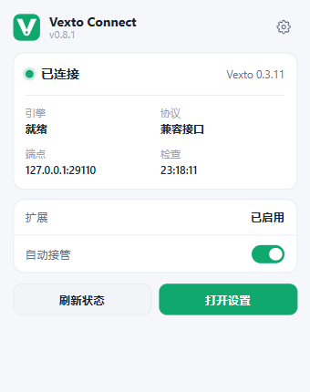

# Vexto Connect

把浏览器下载交给本机 Vexto，让下载回到桌面下载器。

Vexto Connect 是 [Vexto](https://github.com/Ruxsmiles/vexto) 的配套浏览器扩展。安装后，网页里的下载和链接右键菜单可以直接进入 Vexto 的下载队列，由 aria2c 接管；Vexto 未运行、拒绝接收或响应超时时，扩展会自动恢复浏览器下载并说明原因，不丢任务。

**项目仓库**：<https://github.com/Ruxsmiles/vexto-connect>

**当前版本**：0.9.1 · Manifest V3 · Edge / Chrome 109+ · Firefox 128+ · GPL-3.0

界面支持 English、简体中文、日本語、한국어、Español 五种语言，跟随浏览器界面语言自动切换。


## 功能一览

| 功能 | 说明 |
|---|---|
| 自动接管 | 浏览器开始下载时先交给 Vexto，成功后不再经过浏览器下载管理 |
| 失败回落 | Vexto 未运行、密钥不一致、超时或拒绝时，恢复浏览器下载并提示原因 |
| 右键下载 | 在链接上右键选择「用 Vexto 下载」，适合临时任务 |
| 工具栏弹窗 | 查看连接状态、Vexto 版本、引擎与协议，快速开关自动接管 |
| 站点规则 | 允许 / 排除域名，按域名后缀匹配 |
| 大小与重复过滤 | 最小文件大小、大小未知时的策略、重复下载保护窗口 |
| 请求头转发 | 默认转发 Referer 与 User-Agent，兼容常见防盗链 / UA 校验 |
| Cookie 转发 | 默认关闭，按需开启，用于需要登录态的下载 |
| 隐藏下载列表 | Chrome / Edge 接管期间隐藏下载栏与气泡，回落时恢复 |
| 诊断记录 | 保留最近 50 条交接结果，只记录主机与原因码 |
| 多语言界面 | 英文 / 简体中文 / 日文 / 韩文 / 西班牙文，跟随浏览器界面语言 |

## 下载与安装

Vexto Connect 在 GitHub 开源发布：

- **项目仓库**：<https://github.com/Ruxsmiles/vexto-connect>
- **下载源码 ZIP**：<https://github.com/Ruxsmiles/vexto-connect/archive/refs/heads/main.zip>
- **使用 Git**：

```bash
git clone https://github.com/Ruxsmiles/vexto-connect.git
```

下载后解压，得到包含 `manifest.json` 的目录，然后按下面的步骤加载。

### 前置条件

1. 安装并运行 [Vexto](https://github.com/Ruxsmiles/vexto)（建议 0.3.11 或更高版本）。
2. 在 Vexto 设置中开启「插件接管」，确认端口（默认 `29110`）。
3. 如果 Vexto 设置了「插件密钥」，稍后在扩展选项页填写相同密钥。

### Chrome / Edge

1. 打开扩展管理页：
   - Edge：`edge://extensions`
   - Chrome：`chrome://extensions`
2. 打开「开发者模式」。
3. 点击「加载已解压的扩展程序」，选择包含 `manifest.json` 的目录。
4. 打开 Vexto Connect 的选项页，确认主机 `127.0.0.1`、端口 `29110`。
5. 按需填写密钥，点击「测试连接」，确认显示「已连接」后保存。
6. 确认「自动接管浏览器下载」已开启（默认开启）。

### Firefox

Firefox 使用独立清单，需要先从源码生成 Firefox 包：

```powershell
powershell -ExecutionPolicy Bypass -File scripts/package-firefox.ps1
```

然后：

1. 解压 `dist/vexto-connect-firefox-<版本号>.zip`。
2. 打开 `about:debugging#/runtime/this-firefox`。
3. 点击「临时载入附加组件」，选择解压目录中的 `manifest.json`。
4. 打开扩展选项页，确认端口与密钥，点击「测试连接」。

临时载入的扩展在 Firefox 重启后失效；长期使用需要发布到 AMO 获取签名，或使用未列出（unlisted）签名包。

### 更新

重新下载源码并替换原目录，然后在扩展管理页点击「重新加载」。设置保存在浏览器本地，重新加载不会丢失。

## 使用

### 自动接管

在选项页「自动接管」中开启并保存。之后浏览器开始下载时：

- 下载会先被暂停，扩展在 1 秒内请求 Vexto；
- Vexto 接收：取消并清除浏览器下载，任务出现在 Vexto 中；
- Vexto 拒绝、未运行、密钥不一致或超时：恢复浏览器下载，并通知具体原因。

### 工具栏弹窗



点击浏览器工具栏里的 Vexto Connect 图标，可以快速查看：

- 当前连接状态（已连接 / 未连接 / 引擎未启用 / 密钥不一致 / 扩展已停用）；
- Vexto 版本、引擎、协议、端点与最近检查时间；
- 「自动接管」快捷开关；
- 「刷新状态」与「打开设置」入口。

弹窗打开期间每 5 秒自动刷新一次。

### 右键下载

在链接上右键选择「用 Vexto 下载」。这是显式操作，不受站点规则、大小或重复保护限制。

### 过滤规则

- **站点规则**：每行一个域名，按域名后缀匹配（`example.com` 同时匹配 `sub.example.com`）；允许列表非空时只接管命中的站点。
- **最小文件大小**：小于该值的下载不接管；大小未知时按「仍然接管」开关决定。
- **重复保护**：同一 URL 与文件名在窗口时间内只交给 Vexto 一次。

### 隐藏下载列表

开启后需要授权可选的「下载 UI」权限。隐藏只在接管尝试期间生效：接管成功不会留下浏览器下载项，回落到浏览器下载时列表会恢复显示。

## 兼容性

| 浏览器 | 支持情况 |
|---|---|
| Microsoft Edge 109+ | 支持，已在 Edge 158 完整实测 |
| Google Chrome 109+ | 支持，已在 Chrome 158 完整实测 |
| Mozilla Firefox 128+ | 支持，已在 Firefox 160 实测（自动接管、回落、诊断） |
| Brave / Opera / Vivaldi 等 Chromium 浏览器 | 理论可用，未逐一实测 |
| Safari | 不支持（扩展模型与下载 API 不同） |
| 移动端浏览器 | 不支持（移动版 Chrome / Edge 不支持扩展） |

界面支持 English、简体中文、日本語、한국어、Español，默认跟随浏览器界面语言（`_locales` 的 `default_locale` 为 `en`，其余语言缺 key 时自动回落到英文）；扩展名称与描述也随语言切换。本文档仍以中文维护。

Vexto 侧需要开启插件接管。当前扩展使用 Vexto 的兼容接口；Vexto 提供 `/v1` 接口后会自动切换。
## 隐私与权限

- **只访问本机**：所有主动网络请求都发往 `http://127.0.0.1` 或 `http://localhost`，不访问公网。Firefox 版额外使用 `webRequest` 观察 `github.com` 的下载请求，仅在内存中匹配原始下载地址，不读取页面内容、不上传数据。
- **不收集数据**：没有统计、遥测、账号体系或远程上报。
- **Cookie 默认不转发**：只有用户主动开启后，才会读取当前站点 Cookie 并发送给本机 Vexto；Cookie 与密钥不写入日志。
- **密钥只存本地**：保存在 `chrome.storage.local`，不使用同步存储。
- **诊断已脱敏**：只记录主机与原因码，不记录 URL 查询串、Cookie、密钥或文件名；浏览器会话结束即清空。
- **无远程代码**：不加载远程脚本，不使用 `eval` / `new Function`，CSP 使用 Manifest V3 默认值。
- **可审计**：全部代码为纯静态 HTML / CSS / JS，无构建产物。

<details>
<summary>权限说明</summary>

| 权限 | 类型 | 用途 |
|---|---|---|
| `storage` | 必需 | 保存设置与诊断记录 |
| `contextMenus` | 必需 | 注册「用 Vexto 下载」右键菜单 |
| `downloads` | 必需 | 暂停、取消、恢复浏览器下载 |
| `notifications` | 必需 | 回落时提示失败原因 |
| `cookies` | 必需 | 可选的 Cookie 转发（默认关闭，开启后才读取） |
| `webRequest` | 必需（仅 Firefox） | 在跳转前识别 GitHub Release 的原始下载地址 |
| `downloads.ui` | 可选（仅 Chrome / Edge） | 隐藏浏览器下载列表；Firefox 不支持该 API |
| `http://127.0.0.1/*`、`http://localhost/*` | 必需 | 访问本机 Vexto API |
| `*://github.com/*` | 必需（仅 Firefox） | 配合 `webRequest` 读取 GitHub Release 下载地址 |
| `*://*/*` | 可选 | 仅在开启 Cookie 转发时申请，用于读取站点 Cookie |

扩展只申请完成上述功能所需的最小权限；可选权限只在用户主动开启对应功能时申请。

</details>

## 常见问题

| 现象 | 可能原因与处理 |
|---|---|
| 测试连接提示「无法连接」 | Vexto 未运行、端口不一致，或 Vexto 未开启插件接管 |
| 提示「密钥不一致（401）」 | 扩展与 Vexto 的插件密钥必须完全相同；两边都为空也算一致 |
| 下载没有被接管 | 检查扩展是否启用、自动接管是否开启，以及站点 / 大小 / 重复规则是否命中 |
| 下载被接管但浏览器里还有文件 | 浏览器下载取消失败，通知中会给出原因与文件路径，可手动删除 |
| 接管时仍短暂出现下载列表 | 浏览器全局 UI 开关的时序限制，见下方「已知限制」 |
| 右键没有「用 Vexto 下载」 | 扩展被停用，或页面加载于扩展启用之前；刷新页面后重试 |
| 通知点击无反应 | 通知会打开选项页；若浏览器阻止，请手动打开扩展选项页 |

### 已知限制

- 隐藏下载列表是浏览器的全局 UI 开关。浏览器创建下载项后扩展才收到通知，下载栏可能短暂闪现；要完全避免只能常驻隐藏，但那样回落的下载也会不可见。
- Firefox 的 `downloads.pause()` 会让下载变成 `USER_CANCELED` 且无法恢复，因此 Firefox 版不暂停下载，而是直接交接；接管成功的下载可能在取消前写入少量数据，随后由扩展删除。
- Firefox 不支持 `downloads.ui`，选项页会自动隐藏「隐藏浏览器下载列表」。
- 小文件可能在暂停生效前就下载完成。接管成功时会删除浏览器副本，回落到浏览器时保留文件。
- 扩展不能启动 Vexto，Vexto 必须保持托盘运行（可开启开机自启）。
- GitHub Release 资源会以 `github.com/.../releases/download/...` 的稳定地址交给 Vexto，而不是带签名的临时 CDN 链接；私有仓库需要开启 Cookie 转发。
- 与其它下载接管类扩展同时开启自动接管会重复拦截，请只启用其中一个。
- 项目处于 0.x 阶段，设置项与行为可能随版本调整。

## 开发与反馈

- 源码、Issue、Pull Request：<https://github.com/Ruxsmiles/vexto-connect>
- Manifest V3，纯静态 HTML / CSS / JS，**无 npm、无构建步骤、无前端框架**。
- 修改后在扩展管理页点击「重新加载」即可生效。
- 界面文案走浏览器原生 `_locales`（见下方「多语言」），打包前会自动校验。
- 打包脚本：
  - Chrome / Edge：`powershell -ExecutionPolicy Bypass -File scripts/package.ps1`
  - Firefox：`powershell -ExecutionPolicy Bypass -File scripts/package-firefox.ps1`

欢迎提交 Issue 和 Pull Request。请保持以下约束：

- 不引入 npm、打包器、TypeScript 或前端框架；
- 不加载远程脚本或公网资源；
- 界面文案必须走 `_locales`，不得在 HTML / JS 里写死某一种语言；
- 错误必须对用户可见；
- PR 中说明改动内容与测试方式。

### 多语言

界面语言由浏览器界面语言决定，扩展内不提供切换器。实现方式：

- `_locales/{en,zh_CN,ja,ko,es}/messages.json` 五份文案，`manifest.json` 与 `manifest.firefox.json` 用 `__MSG_extName__` / `__MSG_extDescription__` 占位；
- 页面用 `data-i18n="key"`（文本）与 `data-i18n-attr="title:key,aria-label:key"`（属性）标记，`common.js` 的 `localizeDocument()` 统一填充；
- 脚本里的动态文案统一走 `t("key", [参数…])`，占位符用 `$NAME$` 声明；
- 新增或修改文案后运行检查脚本（无依赖，Node 18+）：

```bash
node scripts/check-i18n.mjs
```

它会校验五份文件的 key 是否对齐、是否有空值、占位符是否定义一致，以及 manifest / HTML / JS 引用的 key 是否都存在、有没有定义了却没人用的 key。两个打包脚本会先跑这项检查，未通过则中止打包。

临时用别的语言调试：把 `manifest.json` 的 `default_locale` 改成 `zh_CN` / `ja` / `ko` / `es` 后重新加载扩展，或直接把浏览器界面语言切换成目标语言。

### 发布

创建 GitHub Release（tag 与 `manifest.json` 版本一致，例如 `v0.9.1`）后，`.github/workflows/publish.yml` 会自动构建三个包（Chrome / Edge / Firefox）并提交到 Edge Add-ons 与 AMO；配置 Chrome 相关 Secrets 后也会提交到 Chrome Web Store。

需要的 Repository secrets：`EDGE_PRODUCT_ID`、`EDGE_CLIENT_ID`、`EDGE_API_KEY`、`AMO_API_KEY`、`AMO_API_SECRET`；Chrome 可选：`CHROME_ITEM_ID`、`CHROME_CLIENT_ID`、`CHROME_CLIENT_SECRET`、`CHROME_REFRESH_TOKEN`。缺少某个商店的 Secrets 时会跳过该商店。

商店审核通过后，已安装用户由浏览器自动更新；首次上架仍建议先在商店后台手动提交。


## 许可

[GNU General Public License v3.0](LICENSE)，与 [Vexto](https://github.com/Ruxsmiles/vexto) 主项目一致。

## 致谢

感谢 [Vexto](https://github.com/Ruxsmiles/vexto) 提供桌面端与下载引擎。

接口与 Vexto 的兼容层对接，存量安装可直接迁移。
